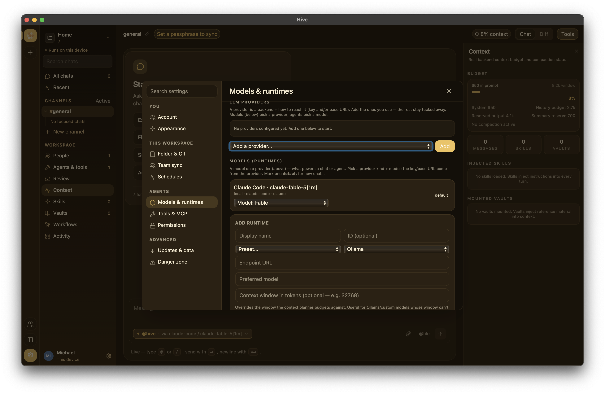

# Configuring a runtime

A *runtime* is whatever LLM (or CLI agent) actually generates the
replies in a chat. Hive doesn't talk to a single hard-coded provider
— you configure as many runtimes as you want, and chats pick one per
session.

Open **Settings → Models** to add or edit.

{ width="800" }

## Supported providers

| Provider          | What it is                                       | Auth                      | Tools? |
|-------------------|--------------------------------------------------|---------------------------|--------|
| `ollama`          | Local Ollama daemon (spoken natively)            | none                      | yes (MCP tools) when the runtime's **Supports tools** switch is on and the model reports tool support |
| `openai`          | OpenAI's API (or any OpenAI-compatible endpoint) | `OPENAI_API_KEY` env / pasted key | yes (MCP tools) |
| `anthropic`       | Anthropic's API                                  | `ANTHROPIC_API_KEY` env / pasted key | yes (MCP tools) |
| `openrouter`      | OpenRouter aggregator                            | `OPENROUTER_API_KEY` env / pasted key | yes (MCP tools) |
| `claude-code`     | Local `claude` CLI (uses your Claude Pro/Max sub) | depends on Claude CLI     | yes (Claude Code's own tools) |
| `aider`           | Local `aider` CLI                                | depends on aider's config | yes (aider's own tools) |
| `pi`              | Local `pi` CLI                                   | depends on pi's config    | yes (pi's own tools) |
| `codex`           | Local `codex` CLI (OpenAI's `codex exec`)        | the CLI's own login       | yes (Codex's own tools) |
| `antigravity`     | Local `agy` CLI (Google Antigravity; uses your Google AI Pro/Ultra sub) | the CLI's own Google sign-in | yes (the CLI's own tools) |
| `copilot`         | Local `copilot` CLI (GitHub Copilot; uses your Copilot sub) | `copilot login` or a token env var | yes (the CLI's own tools) |
| `hermes`          | Any stdin-driven CLI agent (set the executable and flags on the runtime) | depends on the CLI | the CLI's own |
| `hive-daemon`     | Remote `hived` instance                          | bearer token              | passthrough |
| `custom`          | OpenAI-compatible HTTP endpoint                   | varies                    | varies |

`claude-code`, `aider`, `pi`, `codex`, `antigravity`, `copilot` and
`hermes` are the **subprocess** runtimes: Hive launches a local CLI, which
brings its own tools and its own login, so these runtimes need no API key
in Hive. To point Hive at some other OpenAI-compatible server, use
`custom`.

## Provider presets

When you add a runtime in **Settings → Models**, the picker offers
**presets** that pre-fill the endpoint and capability flags so you don't
have to remember them:

- **OpenAI** — `api.openai.com`.
- **OpenRouter** — the OpenRouter aggregator.
- **Azure OpenAI** — an Azure deployment endpoint (your
  `https://<resource>.openai.azure.com` URL + deployment name).
- **Ollama** — your local Ollama daemon.
- **Local gateway (llama.cpp, OpenAI-compatible)** — a `custom` runtime
  for llama.cpp servers behind an OpenAI-compatible gateway, with tools
  on. Replace `<host>` in the endpoint with the gateway's address. See
  [Offline setup with local models](offline-local-models.md).
- **Custom** — any other **OpenAI-compatible** HTTP endpoint; fill in the
  base URL yourself.

All of these are OpenAI-wire-compatible, so the same multi-turn tool loop works
across them. Pick the closest preset, then adjust the endpoint, model id,
and API key as needed.

## Runtime config schema

Each runtime is a `[[runtimes]]` block in `hive.config.toml`. The
Settings UI is a GUI over the same fields:

```toml
[[runtimes]]
id = "anthropic-claude"
name = "Anthropic Claude"
provider = "anthropic"
kind = "remote"
endpoint = "https://api.anthropic.com"
preferred_model = "claude-sonnet-4-5"
supports_tools = true
performance_score = 9.5
cost_per_1m_input_tokens_usd = 3.0
```

For subprocess agents (aider, pi), `endpoint` is the binary path:

```toml
[[runtimes]]
id = "aider"
name = "Aider"
provider = "aider"
kind = "local"
endpoint = "/usr/local/bin/aider"
preferred_model = "gpt-4o"
supports_tools = true
```

See the [Configuration reference](../reference/config-toml.md) for
every field.

## API providers — environment variables

For API providers, Hive can read the credential from an environment
variable you control. Set it in your shell config before launching:

```bash
# ~/.zshrc
export ANTHROPIC_API_KEY="sk-ant-..."
export OPENAI_API_KEY="sk-..."
export OPENROUTER_API_KEY="sk-or-..."
```

Environment variables are a convenient fallback — quitting and
relaunching picks up new ones. Note that a key you paste into
**Settings → Models** is **saved to disk** in `settings.json` under
the app data dir (so it persists across launches); it is stored in
plain text, protected only by your OS account and disk encryption. Use
the env-var path if you'd rather the key never be written by Hive.

## Subprocess agents — installing the binary

Aider and pi are user-supplied CLIs; install them yourself and point
Hive at the binary:

=== "Aider"

    ```bash
    pip install aider-chat
    which aider
    # → /usr/local/bin/aider
    ```

    Then point Hive at `/usr/local/bin/aider`.

=== "pi"

    Install the **pi** CLI (an OpenAI-compatible coding-agent backend),
    then point Hive at its binary:

    ```bash
    which pi
    # → /usr/local/bin/pi
    ```

    Hive bootstraps a temporary `models.json` and `PI_CODING_AGENT_DIR`
    so `pi` can reach your configured OpenAI-compatible endpoint (see
    `crates/hive-runtime/src/provider/subprocess.rs`).

For any other OpenAI-compatible server, don't install a binary — add a
**Custom** runtime (`provider = "custom"`) and fill in the base URL, as
described under [Provider presets](#provider-presets).

## Subscription CLIs: Google Antigravity and GitHub Copilot

If you pay for **Google AI Pro / Ultra** or **GitHub Copilot**, Hive can use
that subscription through the vendor's own CLI, the same way the
`claude-code` runtime uses a Claude subscription. Hive runs the CLI headless
and streams its reply, including its tool steps. The sign-in stays in the
CLI's own config or your OS keychain: Hive never reads, copies or syncs it.

| | Google Antigravity | GitHub Copilot |
|---|---|---|
| Binary | `agy` | `copilot` |
| Install | `curl -fsSL https://antigravity.google/cli/install.sh \| bash` | `brew install --cask copilot-cli` or `npm install -g @github/copilot` |
| Sign in (in a terminal on the same machine) | run `agy` once and choose **Sign in with Google** | `copilot login` |

!!! note "Gemini CLI"
    Gemini CLI stopped serving Google AI Pro / Ultra and free personal
    sign-ins on 2026-06-18 (API-key and Code Assist Standard/Enterprise use
    is unaffected). Hive shows an installed `gemini` binary only to point
    you at `agy`; it can't be added as a runtime.

### Detection in Settings → Models

**Settings → Models → LLM providers** has a **Subscription CLIs** panel that
lists each CLI it looks for:

- **not installed**: the panel shows the install command.
- Installed: the binary's version and its sign-in state:
    - **signed in**: for Copilot, a login in its `config.json`
      (`~/.copilot`, or `$COPILOT_HOME`), or a token in `COPILOT_GITHUB_TOKEN`,
      `GH_TOKEN` or `GITHUB_TOKEN`. Only the token's presence is checked,
      never its value. A classic personal access token (`ghp_…`) reads as
      not signed in, because Copilot CLI doesn't accept one.
    - **not signed in**: the panel shows the command to run in a terminal
      on this machine (`agy` or `copilot login`).
    - **sign-in not checked**: Antigravity keeps its Google sign-in in the OS
      keychain and has no status command, so the panel doesn't know until
      you click **Check Google sign-in**. That runs `agy models`, which is
      read-only and uses no quota, and also fills the model picker with the
      models it lists.
- **Add runtime** adds a keyless runtime for the CLI in one click. Type a
  model first if you want one; blank uses the CLI's default. Once added,
  the row reads **runtime added**.

**Re-scan** checks again after you install or sign in. Detection never signs
you in or out.

Both CLIs follow Hive's permission setting for Claude Code (**Settings →
Permissions**), mapped to each CLI's own flags; the default is read-only.
The exact flags, and how to set these runtimes up on a `hive serve` or
`hive worker` host (`hive setup`), are in
[Bring-your-own agents](../addons/byo-agents.md#subscription-clis-google-antigravity-and-github-copilot).

In TOML the providers are `antigravity` (or `agy`) and `copilot` (or
`github-copilot`); `endpoint` is the binary, and blank means `agy` or
`copilot` on your `PATH`:

```toml
[[runtimes]]
id = "copilot"
name = "GitHub Copilot CLI"
provider = "copilot"
kind = "local"
endpoint = ""
preferred_model = ""   # blank = the CLI's default model
```

## Picking which runtime a chat uses

When you create a new chat, Hive picks the workspace's
`default_runtime`. Switch per chat from the **Primary runtime** select
just above the composer — it lists every configured runtime; choosing
one re-points that chat.

To have a named agent always use a specific runtime, configure a
[Workspace Agent](../concepts/agents.md) in **Settings → Models** and
address it by its `@handle` from the composer.
